# orange3-nlp

A collection of [Orange3](https://orangedatamining.com) widgets for Natural Language Processing: summarization,
named entity recognition, part-of-speech tagging and visualization, entity-relationship extraction, question answering,
text splitting, text embeddings, retrieval-augmented generation (RAG) with local or hosted models, and Polish sentiment
analysis.

The widgets work on the `Corpus` objects provided by the
[Orange3-Text](https://orange3-text.readthedocs.io) add-on, which is installed automatically.

## Installation

### From Orange

Within the Add-ons installer, click on "Add more..." and type in `orange3-nlp`.

### With pip

Install into the same Python environment as Orange:

```
pip install orange3-nlp
```

Requirements:

- Python 3.11, 3.12 or 3.13 (TensorFlow has no wheels for 3.14 yet)
- Orange3 3.41.0 or newer (supported on Linux and Windows)
- numpy 2.0 or newer. Orange 3.41 and the NLP dependencies (gensim 4.4, faiss, TensorFlow) all support numpy 2.

The add-on pulls in several large libraries (PyTorch via sentence-transformers and flair, TensorFlow, spaCy, gensim),
so the first install takes a while and needs a few gigabytes of disk space.

### Models and services

Most widgets download their models on first use and cache them locally; the first run of a widget can therefore be slow.

| Widget(s) | What is needed |
|-----------|----------------|
| spaCy-based widgets (POS Tagger, POS Viewer, spaCy Embedder, Rule-based Entity-Relationship Extraction) | The spaCy model for the corpus language is downloaded automatically. |
| POS Tagger (Stanza, UDPipe) | The Stanza or UDPipe model for the corpus language is downloaded automatically. |
| Summary widgets (BART, Pegasus, T5, FLAN-T5), Question Answering, E5, SBERT | Hugging Face models are downloaded automatically. |
| FastText Embedder | The Common Crawl vectors for the corpus language are downloaded to Orange's data directory. These files are very large (several GB). |
| Ollama options (Abstractive/Extractive Summary, NER, Ollama RAG, Nomic Embedder, Ollama-based Entity-Relationship Extraction) | A running [Ollama](https://ollama.com) server (default `localhost:11434`) with the model you want to use already pulled. The Nomic Embedder needs `nomic-embed-text`. |
| OpenAI Embedder, Gemini Embedder | An API key, see [API keys](#api-keys). |

### API keys

The OpenAI and Gemini embedders need API keys. Enter them in Orange under **Options > Preferences > API Keys**
(or through the embedder widget's "Configure API Keys..." button). Keys are stored in Orange's settings.

## Widgets

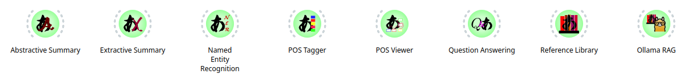

* General Widgets
  * Abstractive Summary
  * Extractive Summary
  * Named Entity Recognition
  * Rule-based Entity-Relationship Extraction
  * Ollama-based Entity-Relationship Extraction
  * POS Tagger
  * POS Viewer
  * Question Answering
  * Reference Library
  * Ollama RAG

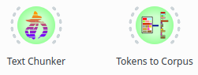

* Text Splitting Widgets
  * Text Chunker
  * Tokens to Corpus

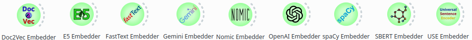

* Text Embedding Models (each outputs an *Embedder*, which the Text Embedder and Reference Library widgets consume)
  * Doc2Vec
  * E5
  * FastText
  * Gemini
  * Nomic
  * OpenAI
  * Sentence Embedder (SBERT)
  * spaCy
  * USE
* Text Embedder (applies an embedder to a corpus)

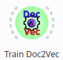

* Training of Text Embedding Widget
  * Train Doc2Vec


* For Polish Sentiment Analysis
  * Analiza Sentymentu

Example workflows are included in the [workflows](workflows) directory. Each widget also has a help page (the Help
button in the widget, or the sources in [doc/widgets](doc/widgets)).

### Summary Widgets

Both summary widgets take a **Corpus** and output a **Corpus with Summaries**. Choose the framework with the radio
buttons; the *Ollama* option reveals host, port and model settings.

- **Extractive Summary** (Sumy, Summa, BART, Ollama): Selects and joins key sentences or phrases from the original text.

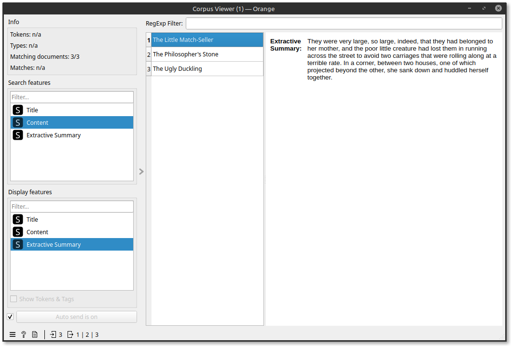

- **Abstractive Summary** (BART, Pegasus, T5, FLAN-T5, Ollama): Generates new sentences that paraphrase and condense the original content (more similar to how humans summarize).

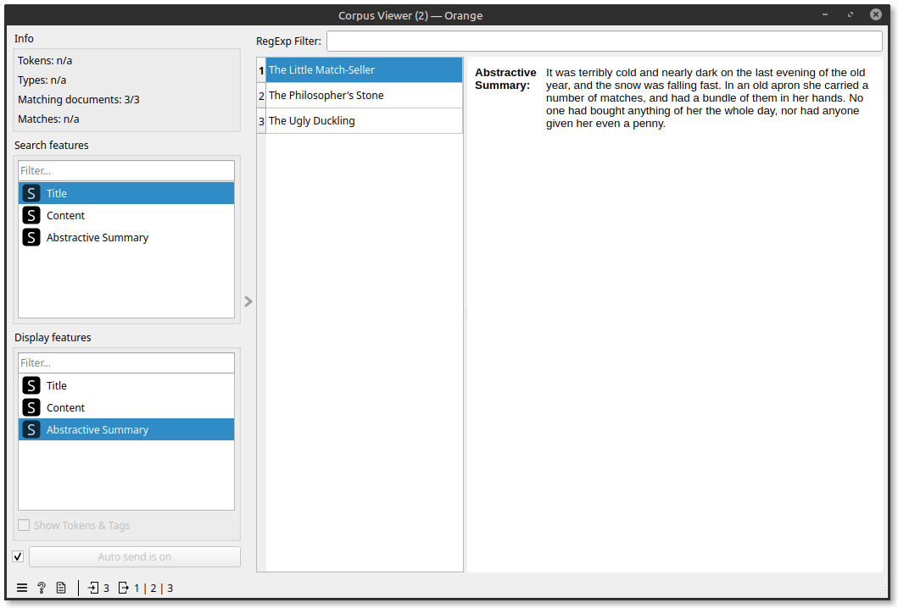

### Named Entity Recognition

**Named Entity Recognition (NER)** is a task in NLP that locates and classifies named entities in text into predefined categories such as:

- **PERSON** – names of people
- **ORG** – organizations
- **GPE** – countries, cities, or locations
- **DATE**, **TIME**, **MONEY**, etc.

The widget takes a **Corpus** and adds a *Named Entities* column listing each entity with its label. Choose NLTK, spaCy,
Flair, or an Ollama model (the Ollama option uses the host, port and model set in the widget and asks the model for a
JSON list of entities, so results depend on the model following that format).

### Entity-Relationship Extraction

Both widgets take a **Corpus** and output a **Relations** table with one row per extracted subject–verb–object triple.
They produce the same columns, so they can be swapped in a workflow:

| Column | Meaning |
|--------|---------|
| `input_chunk_id` | Index of the document the relation came from |
| `subject` | The subject entity |
| `verb` | The relation (a verb, or verb + preposition such as `migrate_to`) |
| `object` | The object entity |
| `sentence` | The sentence supporting the relation |

- **Rule-based Entity-Relationship Extraction** uses spaCy's dependency parse (English). It handles active and passive
  verbs, prepositional relations and copular "is" relations, and ignores discourse verbs such as "show" and "suggest".
  It runs automatically when a corpus arrives.
- **Ollama-based Entity-Relationship Extraction** asks a local Ollama model to extract the triples as structured JSON.
  Configure the host, port, model and (optionally) the prompt, then press **Extract**. It does not run automatically
  because LLM extraction is slow on large corpora. Documents that fail are reported in the error box without stopping
  the rest.

### Part of Speech Tagging

Part-of-speech (POS) tagging assigns grammatical categories to each word in a sentence. The **POS Tagger** (spaCy,
Stanza, UDPipe) adds a *POS Tags* column (JSON) to the corpus.

#### Common POS Tags

| Tag | Meaning       | Example        |
|-----|---------------|----------------|
| NN  | Noun          | `cat`, `city`  |
| VB  | Verb          | `run`, `is`    |
| JJ  | Adjective     | `fast`, `red`  |
| RB  | Adverb        | `quickly`      |
| DT  | Determiner    | `the`, `an`    |
| IN  | Preposition   | `on`, `with`   |

> POS tagging is essential for syntactic parsing and downstream NLP tasks.

#### Part of Speech Viewer

This uses spaCy's displacy HTML renderer to provide a parsed dependency tree of the parts of speech of the input text.
It consumes the **Tagged Corpus** produced by the POS Tagger.

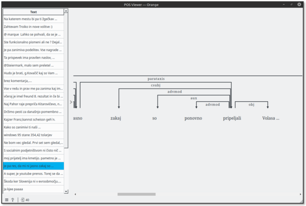

### Question Answering

**Question Answering (QA)** systems aim to extract or generate answers to user questions from a text or knowledge base.
The widget answers the question against the selected document, or against all documents, and adds an *Answer* column.

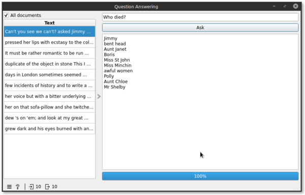

### Text Splitting Widgets

#### Tokens to Corpus

The Tokens to Corpus widget takes the tokens from the Preprocess Text widgets and outputs a corpus with one row per
token (keeping the document title when there is one).

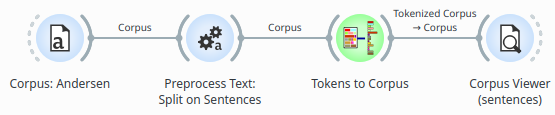

#### Text Chunker

Text Chunker supports 2 chunking strategies to split text, with a chunk size of 128, 256, 512 or 1024 characters. The
first is [LangChain's RecursiveCharacterTextSplitter](https://python.langchain.com/docs/how_to/recursive_text_splitter/)
and the second is [semantic-text-splitter](https://pypi.org/project/semantic-text-splitter/). The output corpus has
`excerpt` and `source_doc_idx` columns.

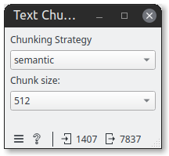

### Text Embeddings

An embedding model widget (Doc2Vec, E5, FastText, Gemini, Nomic, OpenAI, SBERT, spaCy, USE) outputs an *Embedder*.
Connect it, together with a corpus, to **Text Embedder** to add `emb_0 … emb_N` feature columns to the corpus, or to
**Reference Library** to build a searchable index.

**Train Doc2Vec** trains a new gensim Doc2Vec model on a corpus (vector size 300, window 8, minimum count 2, 4 workers,
40 epochs). It has no controls; training starts when a corpus arrives. The trained model is saved in Orange's data
directory and is then available in the Doc2Vec Embedder widget.

### Retrieval-Augmented Generation

**Retrieval-Augmented Generation (RAG)** is a method of enhancing large language model (LLM) responses by *providing external documents as supporting context*. Instead of relying solely on the model's training data, RAG:

- **Retrieves** relevant snippets from a document collection (knowledge base).
- **Augments** the prompt to the LLM by including this retrieved content.
- **Generates** a more accurate and grounded answer based on the context.

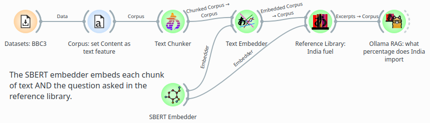

The **Reference Library** stores an embedded corpus in a FAISS vector index and returns the excerpts most similar to a
query (the number of excerpts and a similarity threshold are configurable).

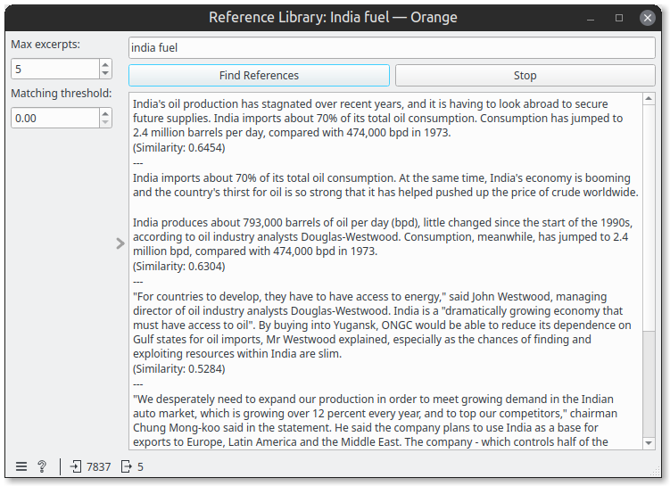

The **Ollama RAG** widget sends the retrieved excerpts, together with your prompt, to an Ollama model and shows the
streamed response.

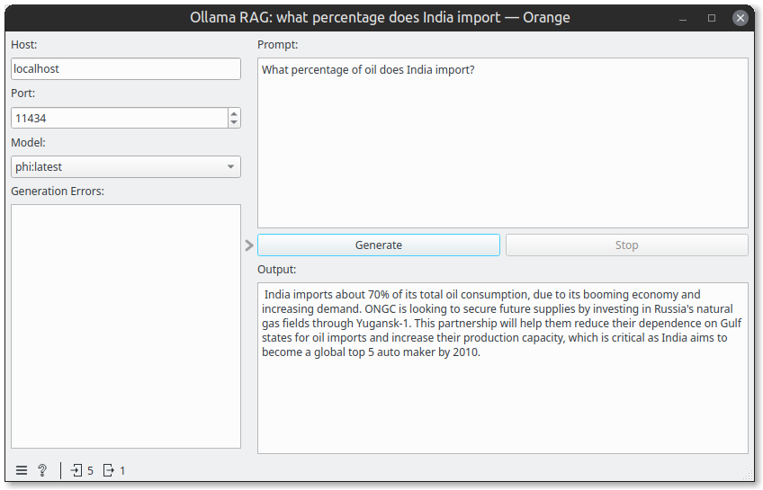

### Polish Sentiment Analysis

Since Polish sentiment analysis support in Orange was limited, Analiza Sentymentu provides a tuned model
([sentimentpl](https://pypi.org/project/sentimentpl/)).

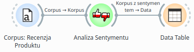

## Localization

Widget names and interface strings can be translated. The translation files are in
[orangecontrib/nlp/i18n](orangecontrib/nlp/i18n) (English and Japanese); the language is chosen in Orange's settings.
In the code, translated strings are looked up by index (`_tr.m[index, "text"]`), so new strings must be appended to
every language file.

## Development

```
git clone https://github.com/chrislee35/orange3-nlp
cd orange3-nlp
pip install -e ".[test,doc]"
```

Code style and checks (configuration is in `pyproject.toml` and `.flake8`):

```
black .                       # formatting, 140 columns
ruff check .                  # linting, including type-annotation (ANN) rules
flake8 .
pyright                       # static type checking (the engine behind Pylance)
```

All functions are type-hinted. The `typings/` directory contains stubs that point `AnyQt` at PyQt5 so that type checkers
can resolve Qt classes. Helpers for typed Orange settings and Qt layouts are in `orangecontrib/nlp/util`.

Tests:

```
python tests/test_nlp.py          # runs each widget in its own process (slow; downloads models, needs Ollama)
python -m pytest tests/test_token_corpus.py
```

Documentation (Sphinx, Markdown pages with MyST) lives in [doc](doc). Build the HTML help before building a wheel so
that it is bundled and shown by the widgets' Help button:

```
cd doc && make html        # or: sphinx-build -b html . _build/html
```

Building a wheel: `python -m build --wheel`. See [CHANGELOG.md](CHANGELOG.md) for release notes.

## License

CC-BY-NC-SA-4.0. See [LICENSE](LICENSE).
