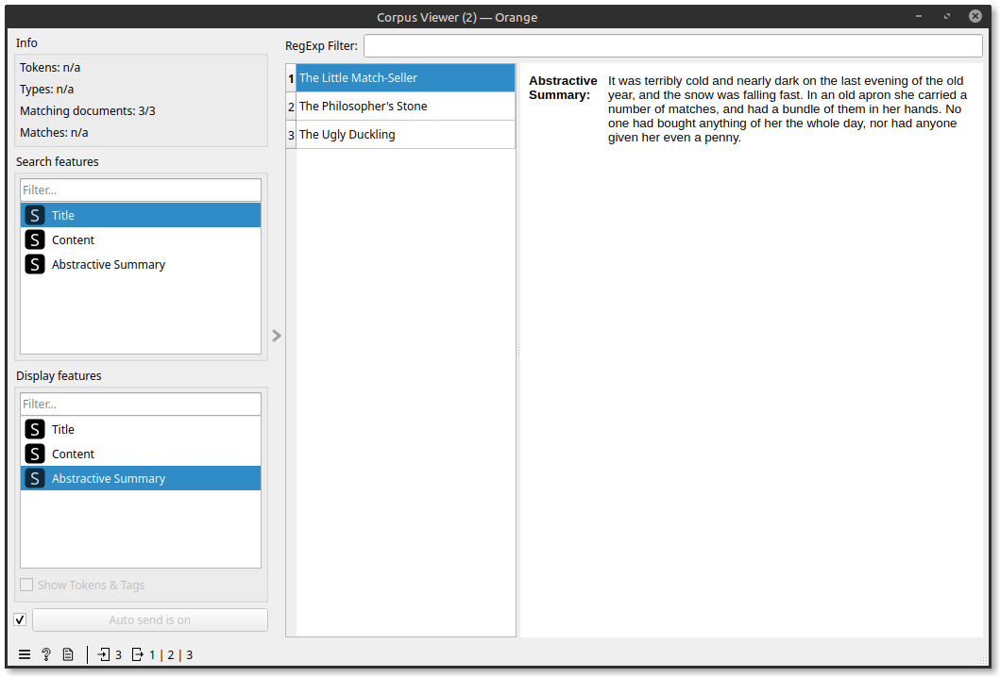

# Abstractive Summary

Generate abstractive summaries from text using various frameworks.

**Inputs**

- Corpus: documents to summarize

**Outputs**

- Corpus with Summaries: the input corpus with an *Abstractive Summary* column

Abstractive summaries paraphrase and condense the original text, much as a person would, instead of copying sentences.

Choose a framework with the radio buttons:

- **BART** (`facebook/bart-large-cnn`)
- **Pegasus** (`google/pegasus-xsum`)
- **T5** (`t5-base`)
- **FLAN-T5** (`google/flan-t5-large`)
- **Ollama**, using a local large language model.

The Hugging Face models are downloaded the first time they are used. Long documents are truncated at a sentence
boundary before summarizing, and documents that are already shorter than the summary length are passed through
unchanged. A document that fails is reported as `Error: ...` in its summary cell and does not stop the rest.
Press **Cancel** to stop a running job.

**Ollama settings.** Selecting *Ollama* shows the server **Host** (default `localhost`), **Port** (default `11434`) and
**Model**. The model list is read from the server; change the host or port and the list refreshes. The model must already
be pulled on the server (`ollama pull <model>`).

