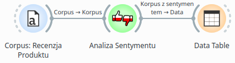

# Analiza Sentymentu

Analiza sentymentu tekstu w języku polskim.

**Inputs**

- Korpus: documents in Polish

**Outputs**

- Korpus z sentymentem: the input corpus with a numeric *score* column

Polish sentiment analysis. Orange's built-in sentiment tools support Polish poorly, so this widget uses the tuned
[sentimentpl](https://pypi.org/project/sentimentpl/) model. It runs automatically when a corpus arrives and adds a
numeric *score* column.

