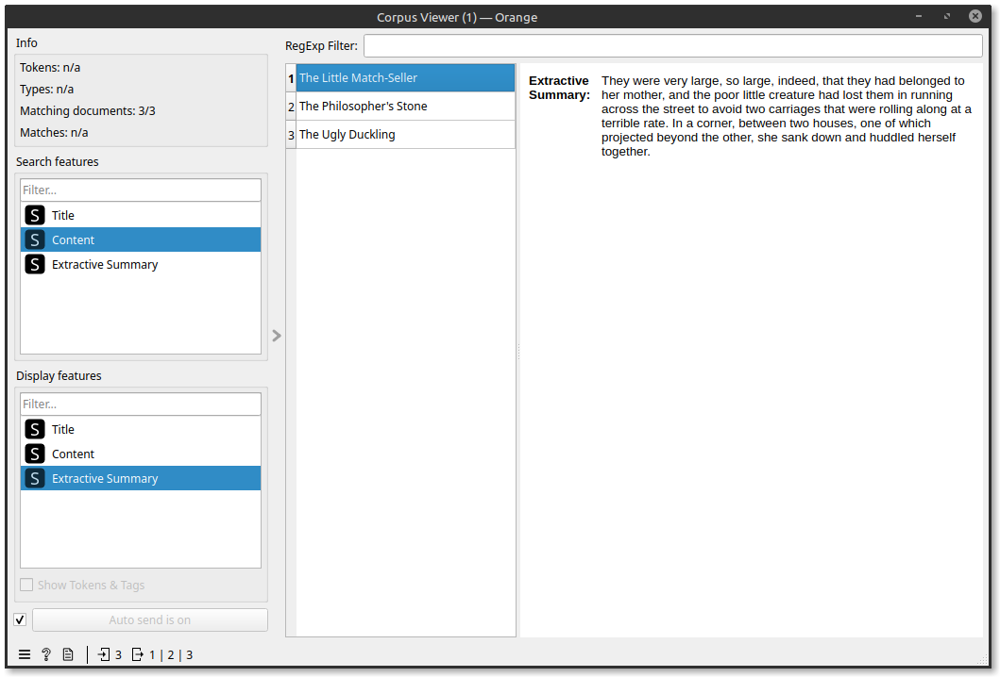

# Extractive Summary

Extract summaries from text using various frameworks.

**Inputs**

- Corpus: documents to summarize

**Outputs**

- Corpus with Summaries: the input corpus with an *Extractive Summary* column

Extractive summaries select and join the most important sentences from the original text.

Choose a framework with the radio buttons:

- **Sumy**
- **Summa** (TextRank)
- **BART**
- **Ollama**, using a local large language model.

Press **Cancel** to stop a running job.

**Ollama settings.** Selecting *Ollama* shows the server **Host** (default `localhost`), **Port** (default `11434`) and
**Model**. The model list is read from the server; change the host or port and the list refreshes. The model must already
be pulled on the server (`ollama pull <model>`).

