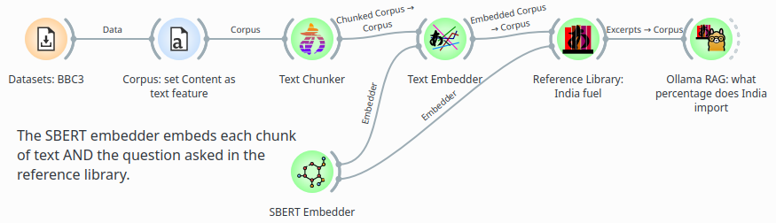
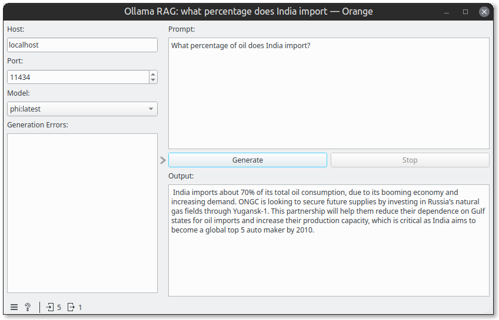

# Ollama RAG

Send RAG prompt to an Ollama model.

**Inputs**

- Corpus: the references (for example the excerpts from Reference Library)

**Outputs**

- Corpus: a one-row corpus with the `prompt`, `model`, `references` and `output`

Sends your prompt, followed by the text of the input documents as references, to an Ollama model and shows the
response as it streams in.

**Controls**

- **Host** and **Port** of the Ollama server, and the **Model** to use.
- **Prompt**, then **Generate**. **Stop** cancels a running generation.
- Server errors appear in the *Generation Errors* box.

