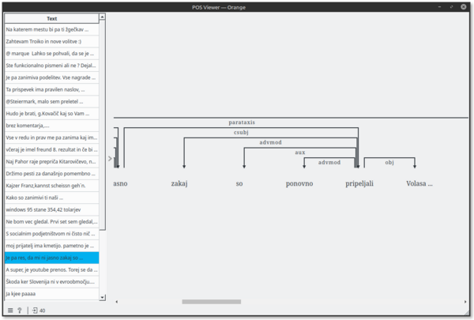

# POS Viewer

Visualize part-of-speech tags and dependency parses.

**Inputs**

- Tagged Corpus: a corpus with a *POS Tags* column (from POS Tagger)

**Outputs**

- none

Shows a dependency tree for the selected document using spaCy's displaCy renderer. The left table lists the first 30
documents; select one to display it.

If the corpus has no *POS Tags* metadata, or the column is not valid POS JSON, the widget says so instead of drawing a
tree.

