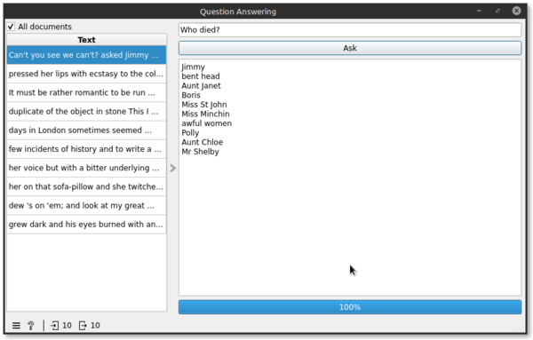

# Question Answering

Answer a question using a text corpus.

**Inputs**

- Corpus: documents to search for the answer

**Outputs**

- Corpus: the input corpus with an *Answer* column

Type a question and press **Ask** (or Enter). The widget uses a Hugging Face extractive question-answering model, which
is downloaded the first time it is used, and finds the answer in the text of each document.

- Select a document in the table to ask the question of that document only.
- Tick **All documents** to ask every document; the *Answer* column is then added to the whole corpus.

