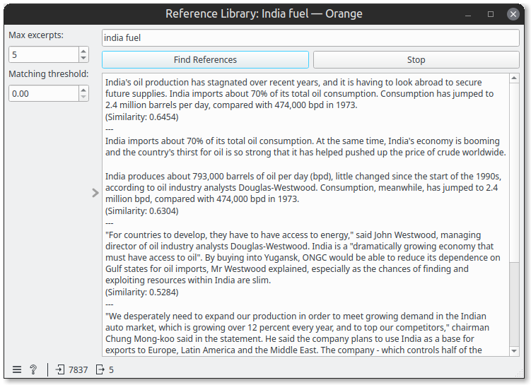

# Reference Library

Stores documents in a vector database and retrieves references.

**Inputs**

- Corpus: documents with embeddings (from Text Embedder)
- Embedder: the embedder used to embed the query

**Outputs**

- Excerpts: the most similar excerpts, with a *score* column

Builds a [FAISS](https://github.com/facebookresearch/faiss) vector index from the `emb_*` columns of an embedded corpus
and finds the excerpts most similar to a query. It is the retrieval step of retrieval-augmented generation (RAG).

The corpus must have been embedded with the *same* embedder that you connect to the second input. Chunk long documents
with [Text Chunker](text-chunker.md) before embedding for better excerpts.

**Controls**

- **Max excerpts**: how many excerpts to return (1–100).
- **Matching threshold**: excerpts with a similarity below this value (0–1) are dropped.
- Type a query and press **Find References** (or Enter).

The output corpus has `excerpt` and `score` columns and can be connected to [Ollama RAG](ollama-rag.md).

