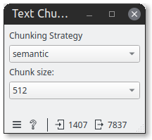

# Text Chunker

Splits text documents into smaller chunks.

**Inputs**

- Corpus: documents to split

**Outputs**

- Chunked Corpus: a corpus with `excerpt` and `source_doc_idx` columns

Splits each document into chunks of at most the selected size (128, 256, 512 or 1024 characters). Two strategies are
available:

- **recursive**: [LangChain's RecursiveCharacterTextSplitter](https://python.langchain.com/docs/how_to/recursive_text_splitter/),
  which splits on paragraph, then line, then word boundaries and overlaps chunks by 10%.
- **semantic**: [semantic-text-splitter](https://pypi.org/project/semantic-text-splitter/), which splits at semantic
  boundaries.

The `source_doc_idx` column holds the index of the document each chunk came from. Chunking is the usual first step before
embedding a corpus for the [Reference Library](reference-library.md).

