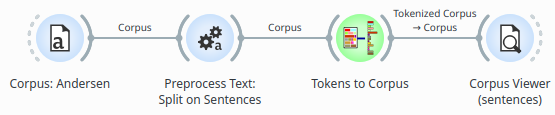

# Tokens to Corpus

Takes tokens from Preprocess Text and outputs them as a Corpus.

**Inputs**

- Corpus: a preprocessed corpus (from Preprocess Text) that has tokens

**Outputs**

- Tokenized Corpus: a corpus with one row per token, in a *Token* column

Turns the tokens produced by Orange's **Preprocess Text** widget into a new corpus with one row per token. If the input
has a title column, the title of the source document is kept next to each token.

Tip: to split documents into paragraphs, set the *Tokenization* method in Preprocess Text to *Regexp* with the pattern
`[^\n]+`; to split into sentences, use *Sentence* tokenization.

