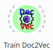

# Train Doc2Vec

Trains a new doc2vec gensim model.

**Inputs**

- Corpus: documents to train on

**Outputs**

- Embedder: the trained Doc2Vec model

Trains a [gensim](https://radimrehurek.com/gensim/) Doc2Vec model on the input corpus and outputs it as an embedder.
Training starts as soon as a corpus arrives and blocks the widget until it finishes.

The widget has no controls; training uses these settings: vector size 300, window 8, minimum count 2, 4 workers,
40 epochs and a maximum vocabulary of 1,000,000 words.

The trained model is saved in Orange's data directory (`gensim` folder) as `<corpus name>.<vector size>.bin`, so it
also appears in the [Doc2Vec Embedder](doc2vec-embedder.md) widget.

